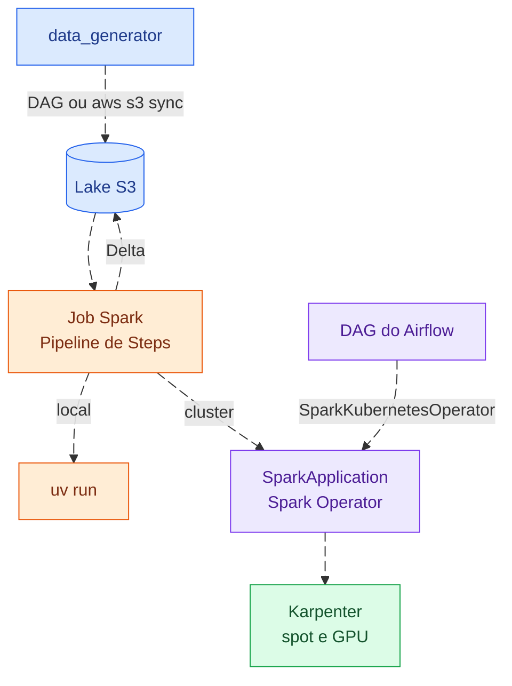

# project-pipeline-distribuited-spark-EKS

Estudo de Spark em Kubernetes. O mesmo job roda local, no EKS (*Elastic Kubernetes
Service*) ou pelo Airflow. No cluster, o Karpenter cria máquinas spot e com GPU
(*Graphics Processing Unit*) só enquanto o job roda, e os dados ficam em Delta no
S3 (*Simple Storage Service*).



## Rodar local

Precisa de [uv](https://docs.astral.sh/uv/) e Java 17; o devcontainer traz os dois.
Sem AWS.

```bash
uv sync
uv run python process/src/airflow/run.py data_generator/main.py <dataset>
uv run python process/src/airflow/run.py data_eng/<processo>/etl/main.py
```

Datasets no
[README do data_generator](process/src/airflow/data_generator/README.md).
O `run.py` recebe o mesmo caminho do `mainApplicationFile` e repassa o resto
dos argumentos ao job. Com GPU local, exporte `SPARK_GPU=true` antes; no
cluster, quem define essa variável é o `Gpu` da DAG.

## Rodar no cluster

Com a [infraestrutura](infrastructure/README.md) de pé:

```bash
aws login
```

1. Imagens de runtime no ECR (*Elastic Container Registry*): o
   `./infrastructure/apply.sh spark` faz o build e o push das que faltam. Só
   têm Spark, Delta, S3, RAPIDS, pyarrow e boto3; o código chega pelo git-sync.
   A tag é imutável: runtime novo, tag nova.

2. Dados no lake: dispare a DAG `data_generator` com o `dataset` desejado ou
   `all`, ou espelhe o que já está em `process/src/datasets/`:

   ```bash
   aws s3 sync process/src/datasets/ s3://kube-system-lake/
   ```

3. Dispare a DAG pela UI do Airflow e acompanhe. O registry chega ao Airflow
   pela variável `ECR_REGISTRY`, que o Terraform do Airflow preenche com a
   conta do `aws login`:

   ```bash
   kubectl get sparkapplication -n spark-jobs
   kubectl logs -n spark-jobs <sparkapplication>-driver -f
   ```

### Pelo Airflow

As DAGs (*Directed Acyclic Graphs*) ficam ao lado de cada job em
`process/src/airflow/` e chegam ao Airflow a cada push na `main`. Cada task
vem de `spark_job()` de `library/kubernetes/`, que recebe `task_id`, `job` (o
pacote do `main.py`), `sources`, `targets` e três enums, `cpu`, `gpu` e
`instances`:

- o `dag_id` é o nome do dataset; cada item de `sources` e `targets` vira o
  argumento `--{nome} s3a://kube-system-lake/{dag_id}/{tabela}` do job;
- a SparkApplication se chama `{dag_id}-{task_id}`;
- sem os enums, cai em `Cpu.MEDIUM`, sem GPU e `Instances.SMALL`;
- `arguments` vai antes de `sources` e `targets`; `driver` (`Cpu.SMALL`) dá o
  tamanho do driver;
- `criticality` escolhe a capacidade de driver e executors: `NORMAL` (padrão)
  usa spot e `CRITICAL` usa on-demand.

| `Cpu`    | Executor        |
| -------- | --------------- |
| `SMALL`  | 1 core, 2g      |
| `MEDIUM` | 2 cores, 4g     |
| `LARGE`  | 4 cores, 8g     |
| `XLARGE` | 8 cores, 16g    |

| `Gpu`    | Memória mínima da GPU | Imagem         |
| -------- | --------------------- | -------------- |
| `None`   | sem GPU               | `spark`        |
| `SMALL`  | 4 GB                  | `spark-rapids` |
| `MEDIUM` | 8 GB                  | `spark-rapids` |
| `LARGE`  | 16 GB                 | `spark-rapids` |
| `XLARGE` | 32 GB                 | `spark-rapids` |

Com GPU, cada executor recebe uma GPU inteira, e o Karpenter escolhe a
instância mais barata do NodePool `spark-gpu` com pelo menos essa memória. A
folga de memória do executor é 40% do `Cpu`, e o *pinned pool* do RAPIDS fica
com metade dela.

| `Instances` | Executors (*dynamic allocation*) |
| ----------- | -------------------------------- |
| `SINGLE`    | 1                                |
| `SMALL`     | 2 a 4                            |
| `MEDIUM`    | 4 a 8                            |
| `LARGE`     | 8 a 16                           |
| `XLARGE`    | 16 a 32                          |

O código não vai na imagem: um initContainer git-sync clona a `main` no pod,
como o Airflow faz com as DAGs. Push na `main` atualiza DAG e job juntos.

## Estrutura

| Pasta                                 | O que tem                          |
| ------------------------------------- | ---------------------------------- |
| `process/src/airflow/`                | pasta de DAGs do Airflow e raiz de |
|                                       | import; `run.py` roda local        |
| `process/src/airflow/library/`        | `Pipeline`, `Step`, `build_spark`  |
|                                       | e o `spark_job`                    |
| `process/src/airflow/data_generator/` | download dos datasets e sua DAG    |
| `process/src/airflow/data_eng/`       | jobs de ETL (*Extract, Transform,  |
|                                       | Load*) e suas DAGs                 |
| `process/src/airflow/data_sci/`       | treino de modelos                  |
| `process/src/images/`                 | imagens Spark com Delta, S3 e      |
|                                       | RAPIDS                             |
| `infrastructure/`                     | EKS, Karpenter, lake e serviços    |

## GPU

| Imagem         | Dockerfile               | O que acelera                    |
| -------------- | ------------------------ | -------------------------------- |
| `spark-rapids` | `images/base-gpu-rapids` | Spark SQL inteiro, sem mudar     |
|                |                          | código                           |

Para conferir se o RAPIDS está ativo nos executors:

```bash
kubectl logs -n spark-jobs <job>-exec-1 | grep -i "rapids\|cuda\|gpu"
```

## Quando algo dá errado

```bash
kubectl describe pod -n spark-jobs <pod>
```

| Sintoma                         | Causa provável                            |
| ------------------------------- | ----------------------------------------- |
| `untolerated taint`             | Falta a toleration no manifesto           |
| `Pending` por mais de 5 min     | Limite de CPU (*Central Processing        |
|                                 | Unit*) do NodePool ou sem spot            |
| `pods is forbidden`             | `serviceAccount` diferente de `spark`     |
| `ImagePullBackOff`              | Tag inexistente no ECR                    |
| `exec format error`             | Imagem ARM: build sem `--platform`        |
| `python: can't open file`       | `mainApplicationFile` fora da imagem      |
| `OOMKilled` (*Out Of Memory*)   | Aumente `memory` do executor              |

Job Python ganha 40% de memória extra: `memory: 8g` vira ~11,2Gi por pod.
