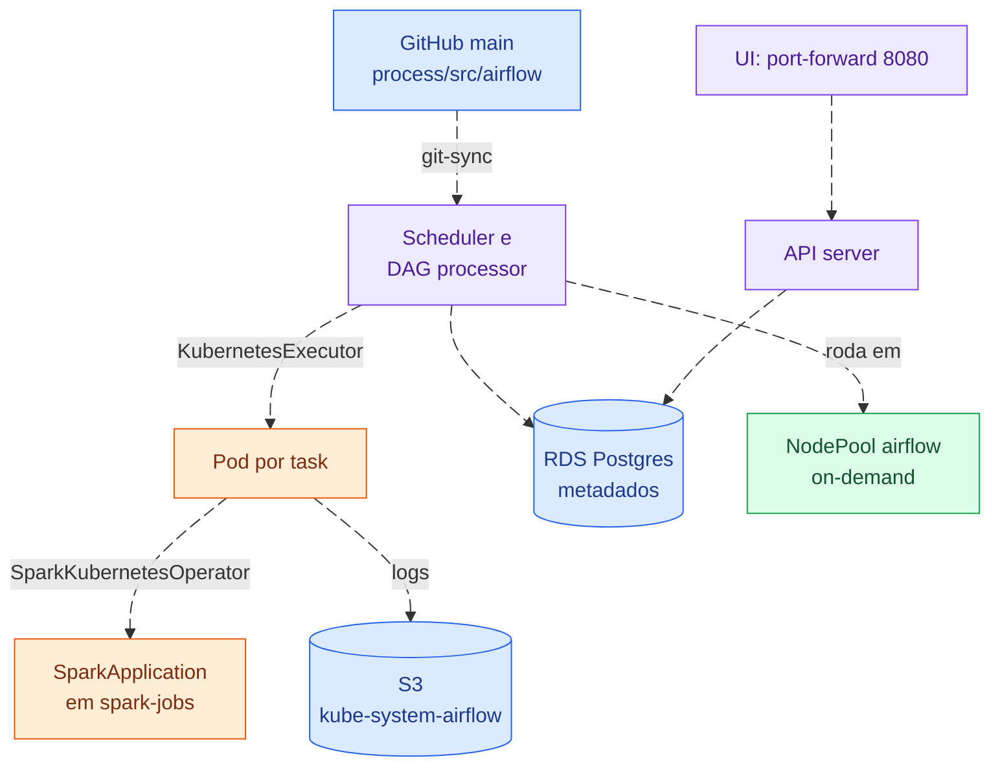

# airflow

Airflow 3 com `KubernetesExecutor`: cada task roda num pod próprio. As DAGs
chegam por git-sync, os metadados ficam num RDS (*Relational Database Service*)
Postgres e os logs das tasks no S3 (*Simple Storage Service*). Comandos no
[README da infraestrutura](../../README.md).

A UI (*User Interface*) é acessada por `port-forward`; o login é `admin` /
`admin`.
