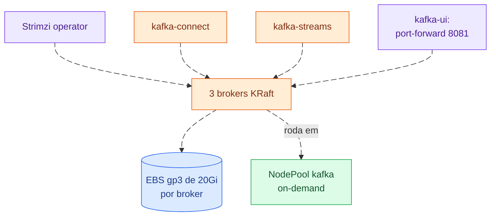

# kafka

Kafka em KRaft (*Kafka Raft*, sem ZooKeeper) gerenciado pelo Strimzi: 3
brokers, cada um com seu volume EBS (*Elastic Block Store*), e o kafka-ui.
Os namespaces e NodePools `kafka-connect` e `kafka-streams` ficam prontos para
os workloads que consomem e produzem. Comandos no
[README da infraestrutura](../../README.md).

A UI (*User Interface*) do kafka-ui é acessada por `port-forward`.
