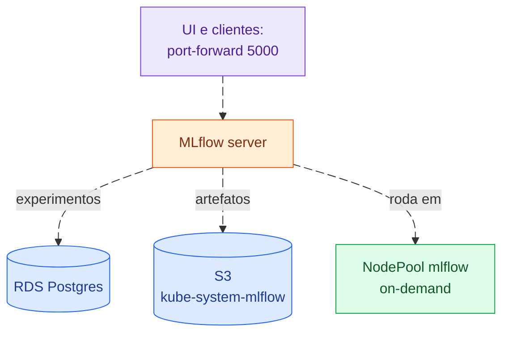

# mlflow

Servidor do MLflow com o backend de experimentos num RDS (*Relational Database
Service*) Postgres e os artefatos no S3 (*Simple Storage Service*), servidos
pelo próprio servidor. Comandos no [README da infraestrutura](../../README.md).

A UI (*User Interface*) é acessada por `port-forward`.
