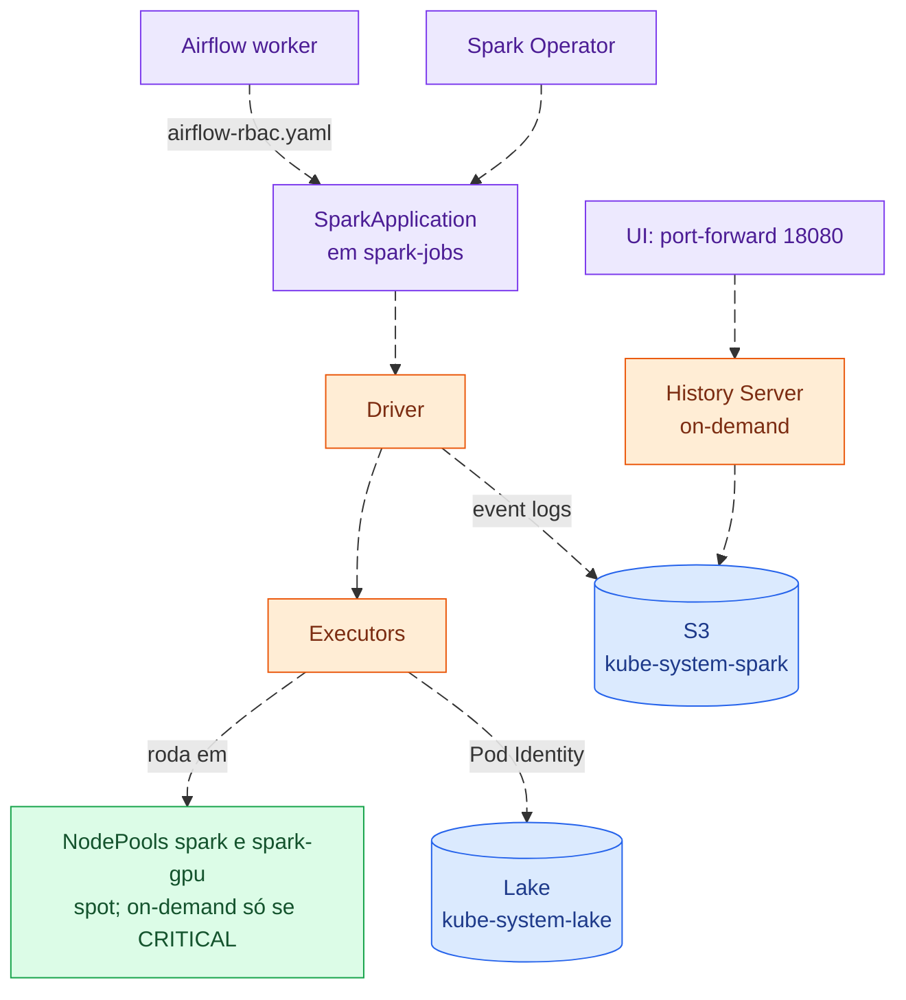

# spark

Spark Operator, NodePools `spark` e `spark-gpu` e Spark History Server. Os jobs
rodam no namespace `spark-jobs`, leem e escrevem no lake do S3 (*Simple Storage
Service*) e gravam os event logs que o History Server mostra. Comandos no
[README da infraestrutura](../../README.md).

A UI (*User Interface*) do History Server é acessada por `port-forward`.
